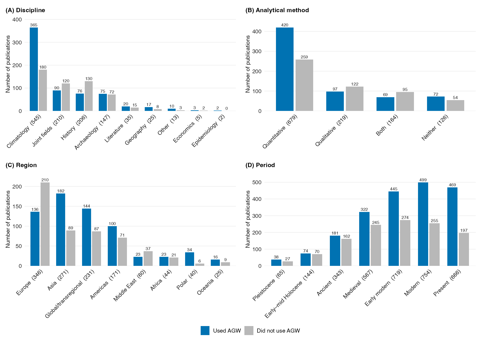
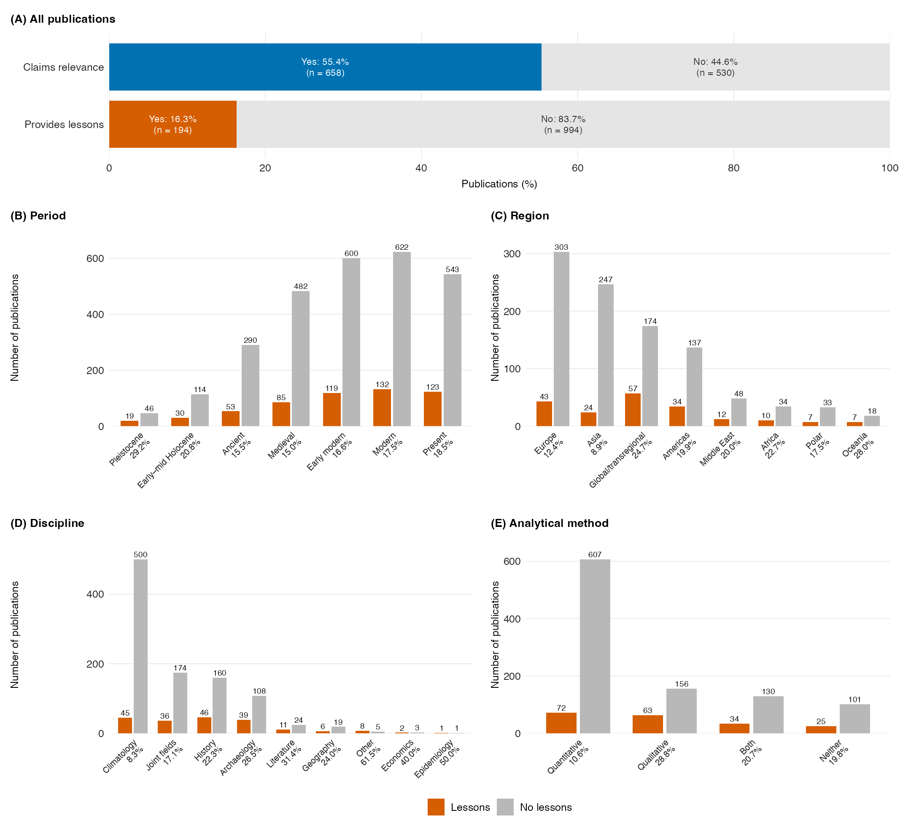
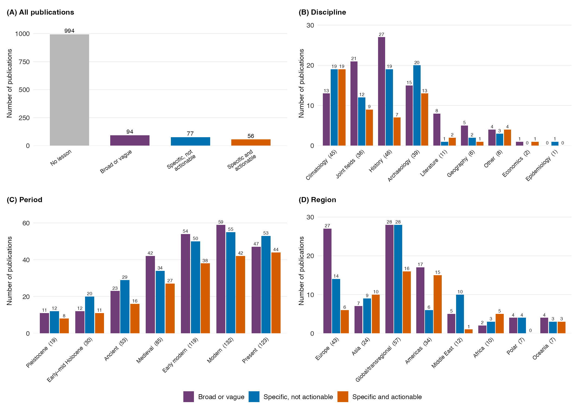
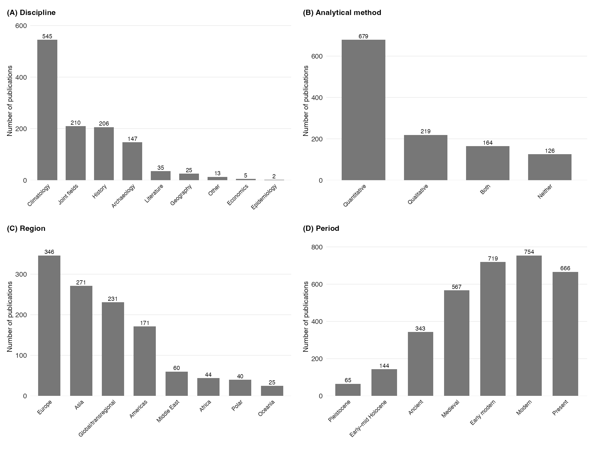
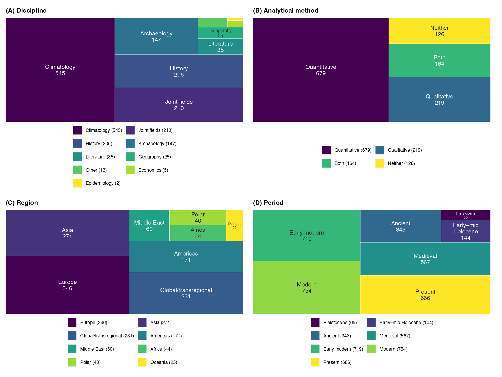

```{r echo = FALSE}
#hide code chunks but show ouptuts
knitr::opts_chunk$set(echo = FALSE, message = FALSE, warning = FALSE)
```

```{r setup}
# Load required packages
library(tidyverse) # for data manipulation
library(readxl) # for pulling data from excel spreadsheet
library(gtsummary) # for summary tables
library(labelled) # for informative variable names
library(grateful) # for citing r packages

theme_set(theme_bw()) # set default plot theme to black and white
theme_gtsummary_compact(font_size = 11) # set default theme for tables

# how many digits to round percentages to
digits <- 0

# category names for use elsewhere
discipline_names <- c('Archaeology', 
                      'Economics', 
                      'Literature', 
                      'Geography', 
                      'History', 
                      'Paleoclimatology', 
                      'Epidemiology', 
                      'Other', 
                      'Joint Fields')

method_names <- c('Qualitative', 
                  'Quantitative', 
                  'Both', 
                  'Neither')

type_names <- c('Original Research', 
                'Lit. Review/Method Intervention', 
                'Response Article')

rec_type_names <- c(c('Broad, abstract, or vague', 
                      'Specific but not actionable', 
                      'Specific and actionable for policymakers', 
                      'Any two of the above', 
                      'All three of the above', 
                      'None of the above'))

rec_types <- c('Broad, abstract, or vague',
               'Specific but not actionable',
               'Specific and actionable',
               NA,
               NA,
               'No recommendation')

american_regions <- c('South America', 
                      "North America", 
                      "Caribbean", 
                      "Central America, South America",
                      'Central America')

periods <- c('Pleistocene',
             'Early-Mid Holocene',
             'Ancient',
             'Medieval',
             'Early Modern',
             'Modern',
             'Present')
```


## Introduction

This is a fully reproducible analysis written in R and Quarto. The source code for this document, including all the R code to preprocess the data, run the analysis, and produce the tables you see below, is available [here on GitHub](https://github.com/nick-gauthier/learning-from-climates-past/blob/main/analysis.qmd).

This analysis pulls data directly from the original Excel Spreadsheet [at this link](https://github.com/nick-gauthier/learning-from-climates-past/blob/main/Limits%20Database%20Final.xlsx), so the tables will update automatically when the analysis is rerun if the spreadsheet changes.

```{r preprocessing}
dat <- read_excel('Limits Database Final.xlsx', sheet = 'Database', range = cell_cols('A:P')) |>
  # rename columns to be more readable
  rename(date = `DATE (BY YEAR AFTER 1975)`, 
         title = `TITLE OF PUBLICATION`,
         method = `TYPE OF ARTICLE 1`,
         type = `TYPE OF ARTICLE 2`,
         discipline = `DISCIPLINE (SEE SHEET 2)`,
         region = `GEOGRAPHIC REGION (SEE SHEET 2)`,
         period = `PERIOD (SEE SHEET 2)`,
         pub_type = `BOOK, THESIS, ARTICLE, CHAPTER?`,
         journal = `JOURNAL TITLE OR BOOK PUBLISHER`,
         argument = `Publication Summary`,
         agw = `DOES ARTICLE USE MODERN ANTHROPOGENIC CLIMATE CHANGE TO ARGUE FOR ITS IMPORTANCE? (Y/N)`,
         rec = `DOES ARTICLE INCLUDE LESSONS OR RECOMMENDATIONS FOR THE PRESENT OR FUTURE (Y/N)?`,
         rec_type = `TYPE OF RECOMMENDATION (SEE SHEET 2)`,
         lesson_text = `LESSONS OR RECOMMENDATIONS FOR THE PRESENT OR FUTURE (ONE SENTENCE)`) |>
  mutate(discipline = discipline_names[discipline],
         method = method_names[method],
         type = type_names[type], 
         # consolidate region names
         region = recode(region,
                         `Central America (Mexico to Panama)` = 'Central America',
                         `Global/Transregional` = 'Global',
                         `Australia/Oceania, including New Guinea and New Zealand` = 'Oceania',
                         `Arctic (above the Arctic Circle)` = 'Arctic',
                         `Middle East, not including Egypt` = 'Middle East'),
         region = if_else(region %in% american_regions, 'Americas', region),
         region = if_else(region == 'Southern Hemisphere', 'Global', region),
         region = if_else(region == 'Australia', 'Oceania', region),
         region = if_else(region %in% c('Arctic', 'Antarctic'), 'Polar', region),
         region = if_else(title %in% 
                            c('On the Interpretation of Natural Archives of Atlantic Tropical Cyclone Activity', 
                              'On the extraordinary winter flood episode over the North Atlantic Basin in 1936'),
                          'Global', region),
         region = if_else(title == 'Climate change facilitated the early colonization of the Azores Archipelago during medieval times', 'Europe', region),
         region = if_else(region == 'N/A', 'Global', region),
         rec_type = as.character(rec_type)
  ) |>
  mutate(period = as.character(period),
         period = map(period, ~str_split_1(.x, ',') |>
                        as.numeric() %>%
                        periods[.] |>
                        factor(levels = periods))) |>
  mutate(rec_type = as.character(rec_type),
         rec_type = map(rec_type, ~str_split_1(.x, ',') |>
                          as.numeric() %>%
                          rec_types[.] |>
                          factor(levels = rec_types))) |>
  filter(pub_type != 'Blog Post') |>
  # add labels so tables are easier to read
  set_variable_labels(discipline = 'Discipline',
                      region = 'Geographic Region',
                      method = 'Method', 
                      period = 'Period',
                      pub_type = 'Publication Type',
                      agw = 'Uses AGW',
                      rec = 'Includes lessons',
                      rec_type = 'Recommendation Type'
  )
```

## Packages Used

```{r}
cite_packages(output = "paragraph", pkgs = 'Session', out.dir = '.')
```



## Simple Questions

### 1. How many publications do we have from each discipline?

```{r tbl1}
dat |>
  select(discipline) |>
  tbl_summary() |>
  modify_header(label = "**Variable**") |>
  bold_labels()
```
### 2. How many publications are from each region?

```{r tbl2}
dat |>
  select(region) |>
  tbl_summary() |>
  modify_header(label = "**Variable**") |>
  bold_labels()
```



### 3. How many publications are from each period?

Note that N is larger here because each paper can cover multiple time periods.

```{r tbl3}
dat |>
  select(period) |>
  unnest(period) |>
  tbl_summary(label = list(period = 'Period')) |>
  modify_header(label = "**Variable**") |>
  bold_labels()
```

### 4. How many of our publications use methods that are quantitative, statistical, both, or neither?

```{r tbl4}
dat |>
  select(method) |>
  tbl_summary() |>
  modify_header(label = "**Variable**") |>
  bold_labels()
```

### 5. How many of our publications are original research, a literature review, or a response article?

```{r tbl5}
dat |>
  select(type) |>
  tbl_summary() |>
  modify_header(label = "**Variable**") |>
  bold_labels()
```



### 6. How many publications are books, "book/theses" (PhD theses), articles, or "chapter/articles" (book chapters)?

```{r tbl6}
dat |>
  select(pub_type) |>
  tbl_summary() |>
  modify_header(label = "**Variable**") |>
  bold_labels()
```

### 7. How many of our publications use AGW to argue for their importance?

```{r tbl7}
dat |>
  select(agw) |>
  tbl_summary() |>
  modify_header(label = "**Variable**") |>
  bold_labels()
```

### 8. How many of our publications include lessons for the present/future?

```{r tbl8}
dat |>
  select(rec) |>
  tbl_summary() |>
  modify_header(label = "**Variable**") |>
  bold_labels()
```

### 9. What types of lessons or recommendations are most common?

Note, some papers can have multiple recommendation types. This analysis counts those separately (like we do for periods) so our N is greater than the number of articles.

```{r tbl9}
dat |>
  select(rec_type) |>
  unnest(rec_type) |>
  tbl_summary() |>
  modify_header(label = "**Variable**") |>
  bold_labels()
```



### 10. Among lessons (so leaving out "none of the above") what types of lessons or recommendations are most common?

```{r tbl10}
dat |>
  filter(rec == 'Yes') |>
  select(rec_type) |>
  unnest(rec_type) |>
  tbl_summary() |>
  modify_header(label = "**Variable**") |>
  bold_labels()
```

### 11. How many of our publications in each discipline use methods that are quantitative, qualitative, both, or neither?

```{r tbl11}
dat |>
  select(discipline, method) |>
  tbl_summary(by = method) |>
  modify_header(label = "**Variable**") |>
  add_p(test.args = all_tests("fisher.test") ~ list(simulate.p.value=TRUE))
```

### 12. How many publications that are *not* in Paleoclimatology/Historical Climatology use Quantitative Analysis?

```{r tbl12}
out <- dat |>
  filter(discipline != 'Paleoclimatology',
         method %in% c('Both', 'Quantitative')) |>
  nrow()
```

`r out` publications from disciplines other than paleoclimatology use quantitative analysis.



### 13. What percentage of publications in every method consider each region?

```{r tbl13}
dat |>
  select(region, method) |>
  tbl_summary(by = method) |>
  modify_header(label = "**Variable**") |>
  add_p(test.args = all_tests("fisher.test") ~ list(simulate.p.value=TRUE))
```

## Compound Questions

For tables that expand publications across multiple periods or lesson types, observations overlap and the independence assumption of these tests is not met; p-values may be too small or too large and should be interpreted cautiously.

### 1. What percentage of publications in each discipline and method use AGW to argue for their importance?

```{r}
dat |>
  select(discipline, method, agw) |>
  tbl_summary(by = agw) |>
  modify_header(label = "**Variable**") |>
  bold_labels() |>
  add_p(test.args = all_tests("fisher.test") ~ list(simulate.p.value=TRUE))
```



### 2a. What percentage of publications in Paleoclimatology/Historical Climatology use modern global warming to argue for their significance? What percentage of publications in all *other* disciplines do the same?

```{r}
dat |>
    mutate(paleo = if_else(discipline == 'Paleoclimatology', discipline, 'All other disciplines')) |>
  select(paleo, agw) |>
  tbl_summary(by = paleo) |>
  modify_header(label = "**Variable**") |>
  add_p()
```

### 2b. What percentage of publications using quantitative analysis use modern global warming to argue for their significance? And what percentage of publications using the other methods do the same?

Note that here we again combine Quantitative and Both categories.

```{r}
dat |>
  mutate(quant = if_else(method %in% c('Quantitative', 'Both'), 'Quantitative', 'Other Methods')) |>
  select(quant, agw) |>
  tbl_summary(by = quant) |>
  modify_header(label = "**Variable**") |>
  add_p()
```

### 3a. What percentage of publications from each region use AGW to argue for their importance?

```{r}
dat |>
  select(region, agw) |>
  tbl_summary(by = agw) |>
  modify_header(label = "**Variable**") |>
  add_p()
```



### 3b. What percentage of publications from each period use AGW to argue for their importance?

```{r}
dat |>
  select(period, agw) |>
  unnest(period) |>
  tbl_summary(by = agw) |>
  modify_header(label = "**Variable**") |>
  add_p()
```

### 4. What percentage of publications that cover each region use global warming to argue for their significance?

```{r}
dat |>
  select(region, agw) |>
  tbl_summary(by = region) |>
  modify_header(label = "**Variable**") |>
  add_p()
```



### 5. What percentage of publications that include lessons come from each discipline? What percentage comes from each method?

```{r}
dat |>
  select(rec, discipline, method) |>
  tbl_summary(by = rec) |>
  modify_header(label = "**Variable**") |>
  bold_labels() |>
  add_p(test.args = all_tests("fisher.test") ~ list(simulate.p.value=TRUE))
```

### 6a. What percentage of publications in each discipline include lessons for the present/future?

```{r}
dat |>
  select(rec, discipline) |>
  tbl_summary(by = discipline) |>
  modify_header(label = "**Variable**") |>
  add_p(test.args = all_tests("fisher.test") ~ list(simulate.p.value=TRUE))
```

### 6b. What percentage of publications in each method include lessons for the present/future?

```{r}
dat |>
  select(rec, method) |>
  tbl_summary(by = method) |>
  modify_header(label = "**Variable**") |>
  add_p()
```

### 7. What percentage of publications that include lessons focus on each region and period?

```{r}
dat |>
  select(region, rec) |>
  tbl_summary(by = rec) |>
  modify_header(label = "**Variable**") |>
  bold_labels() |>
  add_p(test.args = all_tests("fisher.test") ~ list(simulate.p.value=TRUE))
```

```{r}
dat |>
  select(period, rec) |>
  unnest(period) |>
  tbl_summary(by = rec) |>
  modify_header(label = "**Variable**") |>
  add_p()
```

### 8a. What percentage of publications from each region include lessons for the present/future?

```{r}
dat |>
  select(region, rec) |>
  tbl_summary(by = region) |>
  modify_header(label = "**Variable**") |>
  add_p(test.args = all_tests("fisher.test") ~ list(simulate.p.value=TRUE))
```

### 8b. What percentage of publications from each period include lessons for the present/future?

```{r}
dat |>
  select(period, rec) |>
  unnest(period) |>
  tbl_summary(by = period) |>
  modify_header(label = "**Variable**") |>
  add_p()
```

### 9a. What percentage of publications in each discipline include distinct types of recommendation?

```{r}
dat |>
  select(discipline, rec_type) |>
  unnest(rec_type) |>
  tbl_summary(by = discipline) |>
  modify_header(label = "**Variable**") |>
  add_p(test.args = all_tests("fisher.test") ~ list(simulate.p.value=TRUE))
```



### 9b. What percentage of publications in each method include distinct types of recommendation?

```{r}
dat |>
  select(method, rec_type) |>
  unnest(rec_type) |>
  tbl_summary(by = method) |>
  modify_header(label = "**Variable**") |>
  add_p(test.args = all_tests("fisher.test") ~ list(simulate.p.value=TRUE))
```

### 10a. What percentage of publications from each region include distinct types of recommendation?

```{r}
dat |>
  select(region, rec_type) |>
  unnest(rec_type) |>
  tbl_summary(by = region) |>
  modify_header(label = "**Variable**") |>
  add_p(test.args = all_tests("fisher.test") ~ list(simulate.p.value=TRUE))
```



### 10b. What percentage of publications from each period include distinct types of recommendation?

Note, because each paper can have multiple periods *and* recommendation types, there are different ways to do this. Here we just look at all combinations, which is not necessarily the best way to do this!

```{r}
dat |>
  select(period, rec_type) |>
  unnest(period) |>
  unnest(rec_type) |>
  tbl_summary(by = period) |>
  modify_header(label = "**Variable**") |>
  add_p(test.args = all_tests("fisher.test") ~ list(simulate.p.value=TRUE))
```

### 11. What percentage of publications that use AGW to argue for their importance include lessons for the present/future?

```{r}
dat |>
  select(agw, rec) |>
  tbl_summary(by = agw) |>
  modify_header(label = "**Variable**") |>
  add_p() 
```

What percentage of paleosciences/history/literature, etc. articles that use AGW to argue for their importance include lessons for the present/future?

```{r}
dat |>
  filter(agw == 'Yes') |>
  select(discipline, rec) |>
  tbl_summary(by = discipline) |>
  modify_header(label = "**Variable**") |>
  add_p(test.args = all_tests("fisher.test") ~ list(simulate.p.value=TRUE))
```



Same as above, but now broken down by region:

```{r}
dat |>
  filter(agw == 'Yes') |>
  select(region, rec) |>
  tbl_summary(by = region) |>
  modify_header(label = "**Variable**") |>
  add_p(test.args = all_tests("fisher.test") ~ list(simulate.p.value=TRUE))
```

Broken down by period:

```{r}
dat |>
  filter(agw == 'Yes') |>
  select(period, rec) |>
  unnest(period) |>
  tbl_summary(by = period) |>
  modify_header(label = "**Variable**") |>
  add_p() 
```

Broken down by method:

```{r}
dat |>
  filter(agw == 'Yes') |>
  select(method, rec) |>
  tbl_summary(by = method) |>
  modify_header(label = "**Variable**") |>
  add_p()
```

Broken down by publication type:

```{r}
dat |>
  filter(agw == 'Yes') |>
  select(type, rec) |>
  tbl_summary(by = type) |>
  modify_header(label = "**Variable**") |>
  bold_labels() |>
  add_p(test.args = all_tests("fisher.test") ~ list(simulate.p.value=TRUE))
```

Broken down by publication format:

```{r}
dat |>
  filter(agw == 'Yes') |>
  select(pub_type, rec) |>
  tbl_summary(by = pub_type) |>
  modify_header(label = "**Variable**") |>
  add_p()
```

### 12. Are there journals which are particularly correlated with including lessons for the present/future?

Of the journals with 10 or more entries in our database, the following journals have the highest proportion of papers with recommendations for the present or future. However, only Climate and American Literature has a significantly higher proportion of recommendations than the average for all papers, after correcting for multiple comparisons.

```{r}
prop <- dat |>
  select(rec) |>
  mutate(rec = (rec == 'Yes')) |>
  pull(rec) |>
  mean()

dat |>
  mutate(rec = (rec == 'Yes')) |>
  group_by(journal) |>
  summarise(
    n_papers = n(),
    n_recs = sum(rec),
    prop_recs = mean(rec),
    # Run binomial test for each journal
    pval = binom.test(n_recs, n_papers, p = prop)$p.value
  ) |>
  # Filter to journals with reasonable sample sizes
  filter(n_papers >= 10) %>%
  # Add FDR correction
  mutate(
    p_adj = p.adjust(pval, method = "fdr"),
    # Flag significant ones
    significant = p_adj < 0.05
  ) %>%
  arrange(desc(prop_recs))
```

### 13. What percentage of each publication type provides lessons versus AGW justifications?

```{r}
## First, looking at publication types separately
dat |>
  select(pub_type, rec, agw) |>
  tbl_summary(by = pub_type) |>
  modify_header(label = "**Variable**") |>
  bold_labels() |>
  add_p(test.args = all_tests("fisher.test") ~ list(simulate.p.value=TRUE))

## Now, comparing with chapter/article grouped with article
dat |>
  mutate(pub_type_grouped = case_when(
    pub_type %in% c("Article", "Chapter/Article") ~ "Article (combined)",
    TRUE ~ pub_type
  )) |>
  select(pub_type_grouped, rec, agw) |>
  tbl_summary(by = pub_type_grouped) |>
  modify_header(label = "**Variable**") |>
  bold_labels() |>
  add_p(test.args = all_tests("fisher.test") ~ list(simulate.p.value=TRUE))
```


## Publication year

```{r publication-year}
year_results <- dat |>
  group_by(date) |>
  summarise(publications = n(), provides_lessons = sum(rec == 'Yes'),
            percent_providing_lessons = 100 * provides_lessons / publications)
knitr::kable(year_results, digits = 1)
```

## Figures

```{r figure-settings, include=FALSE}
library(patchwork)
dir.create('figures', showWarnings = FALSE)

# Publication counts for each grouping variable
figure_counts <- bind_rows(
  dat |> transmute(group = as.character(discipline), dimension = 'discipline', agw, rec, rec_type),
  dat |> transmute(group = as.character(method), dimension = 'method', agw, rec, rec_type),
  dat |> transmute(group = as.character(region), dimension = 'region', agw, rec, rec_type),
  dat |> unnest(period) |>
    transmute(group = as.character(period), dimension = 'period', agw, rec, rec_type)
) |>
  group_by(dimension, group) |>
  summarise(
    n = n(),
    relevance_n = sum(agw == 'Yes'),
    lessons_n = sum(rec == 'Yes'),
    broad_n = sum(map_lgl(rec_type, ~ 'Broad, abstract, or vague' %in% .x)),
    specific_n = sum(map_lgl(rec_type, ~ 'Specific but not actionable' %in% .x)),
    actionable_n = sum(map_lgl(rec_type, ~ 'Specific and actionable' %in% .x)),
    .groups = 'drop'
  ) |>
  mutate(category = recode(group,
                          Paleoclimatology = 'Climatology',
                          `Joint Fields` = 'Joint fields',
                          `Early-Mid Holocene` = 'Early–mid Holocene',
                          `Early Modern` = 'Early modern',
                          Global = 'Global/transregional'))

orders <- list(
  discipline = c('Paleoclimatology', 'Joint Fields', 'History', 'Archaeology', 'Literature', 'Geography', 'Other', 'Economics', 'Epidemiology'),
  method = c('Quantitative', 'Qualitative', 'Both', 'Neither'),
  region = c('Europe', 'Asia', 'Global', 'Americas', 'Middle East', 'Africa', 'Polar', 'Oceania'),
  period = c('Pleistocene', 'Early-Mid Holocene', 'Ancient', 'Medieval', 'Early Modern', 'Modern', 'Present')
)

theme_set(theme_minimal(base_size = 11) + theme(
  panel.grid.major.y = element_blank(), panel.grid.minor = element_blank(),
  panel.grid.major.x = element_line(colour = 'grey90', linewidth = .3),
  axis.text = element_text(colour = 'grey15', size = 10),
  axis.title = element_text(size = 10),
  axis.title.x = element_text(margin = margin(t = 6)),
  plot.margin = margin(5, 8, 5, 5),
  legend.position = 'bottom', legend.title = element_blank(),
  legend.text = element_text(size = 10), legend.margin = margin(0, 0, 0, 0)
))
blue <- '#0072B2'
rust <- '#D55E00'
figure_theme <- theme(
  plot.title = element_text(size = 11, face = 'bold', hjust = 0, margin = margin(b = 7)),
  plot.title.position = 'plot',
  plot.margin = margin(t = 9, r = 12, b = 12, l = 5),
  panel.grid.major.x = element_line(colour = 'grey90', linewidth = .3)
)
```

### Figure 1

```{r plot-figure-1, include=FALSE}
relevance_discipline <- figure_counts |>
  filter(dimension == 'discipline') |>
  arrange(match(group, orders$discipline)) |>
  mutate(label = paste0(category, '  (', n, ')'),
         label = factor(label, levels = label),
         used = relevance_n,
         not_used = n - relevance_n) |>
  select(label, used, not_used) |>
  pivot_longer(c(used, not_used), names_to = 'response', values_to = 'count') |>
  mutate(response = factor(response, levels = c('used', 'not_used'),
                           labels = c('Used AGW', 'Did not use AGW')))

dodge <- position_dodge(width = .78)
fig1_discipline <- ggplot(relevance_discipline, aes(label, count, fill = response)) +
    geom_col(position = dodge, width = .7) +
    geom_text(aes(label = count), position = dodge, vjust = -.35, size = 2.7) +
    scale_fill_manual(values = c('Used AGW' = blue, 'Did not use AGW' = '#B8B8B8'), drop = FALSE) +
    scale_y_continuous(limits = c(0, NA), breaks = scales::breaks_pretty(n = 4),
      expand = expansion(mult = c(0, .12))) +
    labs(title = '(A) Discipline', x = NULL, y = 'Number of publications', fill = NULL) +
    figure_theme +
    theme(axis.text.x = element_text(angle = 45, hjust = 1),
      panel.grid.major.x = element_blank(),
      panel.grid.major.y = element_line(colour = 'grey90', linewidth = .3))

relevance_method <- figure_counts |>
  filter(dimension == 'method') |>
  arrange(match(group, orders$method)) |>
  mutate(label = paste0(category, '  (', n, ')'),
         label = factor(label, levels = label),
         used = relevance_n,
         not_used = n - relevance_n) |>
  select(label, used, not_used) |>
  pivot_longer(c(used, not_used), names_to = 'response', values_to = 'count') |>
  mutate(response = factor(response, levels = c('used', 'not_used'),
                           labels = c('Used AGW', 'Did not use AGW')))

fig1_method <- ggplot(relevance_method, aes(label, count, fill = response)) +
    geom_col(position = dodge, width = .7) +
    geom_text(aes(label = count), position = dodge, vjust = -.35, size = 2.7) +
    scale_fill_manual(values = c('Used AGW' = blue, 'Did not use AGW' = '#B8B8B8'), drop = FALSE) +
    scale_y_continuous(limits = c(0, NA), breaks = scales::breaks_pretty(n = 4),
      expand = expansion(mult = c(0, .12))) +
    labs(title = '(B) Analytical method', x = NULL, y = 'Number of publications', fill = NULL) +
    figure_theme +
    theme(axis.text.x = element_text(angle = 45, hjust = 1),
      panel.grid.major.x = element_blank(),
      panel.grid.major.y = element_line(colour = 'grey90', linewidth = .3))

relevance_region <- figure_counts |>
  filter(dimension == 'region') |>
  arrange(match(group, orders$region)) |>
  mutate(label = paste0(category, '  (', n, ')'),
         label = factor(label, levels = label),
         used = relevance_n,
         not_used = n - relevance_n) |>
  select(label, used, not_used) |>
  pivot_longer(c(used, not_used), names_to = 'response', values_to = 'count') |>
  mutate(response = factor(response, levels = c('used', 'not_used'),
                           labels = c('Used AGW', 'Did not use AGW')))

fig1_region <- ggplot(relevance_region, aes(label, count, fill = response)) +
    geom_col(position = dodge, width = .7) +
    geom_text(aes(label = count), position = dodge, vjust = -.35, size = 2.7) +
    scale_fill_manual(values = c('Used AGW' = blue, 'Did not use AGW' = '#B8B8B8'), drop = FALSE) +
    scale_y_continuous(limits = c(0, NA), breaks = scales::breaks_pretty(n = 4),
      expand = expansion(mult = c(0, .12))) +
    labs(title = '(C) Region', x = NULL, y = 'Number of publications', fill = NULL) +
    figure_theme +
    theme(axis.text.x = element_text(angle = 45, hjust = 1),
      panel.grid.major.x = element_blank(),
      panel.grid.major.y = element_line(colour = 'grey90', linewidth = .3))

relevance_period <- figure_counts |>
  filter(dimension == 'period') |>
  arrange(match(group, orders$period)) |>
  mutate(label = paste0(category, '  (', n, ')'),
         label = factor(label, levels = label),
         used = relevance_n,
         not_used = n - relevance_n) |>
  select(label, used, not_used) |>
  pivot_longer(c(used, not_used), names_to = 'response', values_to = 'count') |>
  mutate(response = factor(response, levels = c('used', 'not_used'),
                           labels = c('Used AGW', 'Did not use AGW')))

fig1_period <- ggplot(relevance_period, aes(label, count, fill = response)) +
    geom_col(position = dodge, width = .7) +
    geom_text(aes(label = count), position = dodge, vjust = -.35, size = 2.7) +
    scale_fill_manual(values = c('Used AGW' = blue, 'Did not use AGW' = '#B8B8B8'), drop = FALSE) +
    scale_y_continuous(limits = c(0, NA), breaks = scales::breaks_pretty(n = 4),
      expand = expansion(mult = c(0, .12))) +
    labs(title = '(D) Period', x = NULL, y = 'Number of publications', fill = NULL) +
    figure_theme +
    theme(axis.text.x = element_text(angle = 45, hjust = 1),
      panel.grid.major.x = element_blank(),
      panel.grid.major.y = element_line(colour = 'grey90', linewidth = .3))

figure1 <- wrap_plots(fig1_discipline, fig1_method, fig1_region, fig1_period,
                      ncol = 2, guides = 'collect') &
  theme(legend.position = 'bottom')

ggsave('figures/Figure-1.png', figure1, width = 12, height = 8.5, dpi = 180, bg = 'white')
ggsave('figures/Figure-1.pdf', figure1, width = 12, height = 8.5, device = cairo_pdf, bg = 'white')

```

```{r figure-1, out.width="100%"}

```

### Figure 2

```{r plot-figure-2, include=FALSE}
overall_counts <- tibble(
  label = factor(c('Claims relevance', 'Provides lessons'),
                 levels = c('Provides lessons', 'Claims relevance')),
  n = c(sum(dat$agw == 'Yes'), sum(dat$rec == 'Yes'))
) |>
  mutate(value = 100 * n / nrow(dat),
         no = nrow(dat) - n)

fig2_overall <- ggplot(overall_counts, aes(y = label)) +
 geom_col(aes(x = 100), fill = '#E5E5E5', width = .82) +
 geom_col(aes(x = value, fill = label), width = .82) +
 geom_text(aes(x = value / 2,
   label = sprintf('Yes: %.1f%%\n(n = %d)', value, n)),
   colour = 'white', size = 3.2, lineheight = .95) +
 geom_text(aes(x = value + (100 - value) / 2,
   label = sprintf('No: %.1f%%\n(n = %d)', 100 - value, no)),
   colour = 'grey20', size = 3.2, lineheight = .95) +
 scale_fill_manual(values = c('Claims relevance' = blue, 'Provides lessons' = rust), guide = 'none') +
 scale_x_continuous(limits = c(0, 100), breaks = seq(0, 100, 20), expand = c(0, 0)) +
 labs(title = '(A) All publications', x = 'Publications (%)', y = NULL) + figure_theme

dodge <- position_dodge(width = .78)

lessons_period <- figure_counts |>
  filter(dimension == 'period') |>
  arrange(match(group, orders$period)) |>
  mutate(label = paste0(category, '\n', sprintf('%.1f%%', 100 * lessons_n / n)),
         label = factor(label, levels = label),
         yes = lessons_n,
         no = n - lessons_n) |>
  select(label, yes, no) |>
  pivot_longer(c(yes, no), names_to = 'response', values_to = 'count') |>
  mutate(response = factor(response, levels = c('yes', 'no'),
                           labels = c('Lessons', 'No lessons')))

fig2_period <- ggplot(lessons_period, aes(label, count, fill = response)) +
   geom_col(position = dodge, width = .7) +
   geom_text(aes(label = count), position = dodge, vjust = -.35, size = 2.7) +
   scale_fill_manual(values = c('Lessons' = rust, 'No lessons' = '#B8B8B8'), drop = FALSE) +
   scale_y_continuous(limits = c(0, NA), breaks = scales::breaks_pretty(n = 4),
     expand = expansion(mult = c(0, .13))) +
   labs(title = '(B) Period', x = NULL, y = 'Number of publications', fill = NULL) + figure_theme +
   theme(axis.text.x = element_text(angle = 45, hjust = 1, size = 8),
     panel.grid.major.x = element_blank(),
     panel.grid.major.y = element_line(colour = 'grey90', linewidth = .3))

lessons_region <- figure_counts |>
  filter(dimension == 'region') |>
  arrange(match(group, orders$region)) |>
  mutate(label = paste0(category, '\n', sprintf('%.1f%%', 100 * lessons_n / n)),
         label = factor(label, levels = label),
         yes = lessons_n,
         no = n - lessons_n) |>
  select(label, yes, no) |>
  pivot_longer(c(yes, no), names_to = 'response', values_to = 'count') |>
  mutate(response = factor(response, levels = c('yes', 'no'),
                           labels = c('Lessons', 'No lessons')))

fig2_region <- ggplot(lessons_region, aes(label, count, fill = response)) +
   geom_col(position = dodge, width = .7) +
   geom_text(aes(label = count), position = dodge, vjust = -.35, size = 2.7) +
   scale_fill_manual(values = c('Lessons' = rust, 'No lessons' = '#B8B8B8'), drop = FALSE) +
   scale_y_continuous(limits = c(0, NA), breaks = scales::breaks_pretty(n = 4),
     expand = expansion(mult = c(0, .13))) +
   labs(title = '(C) Region', x = NULL, y = 'Number of publications', fill = NULL) + figure_theme +
   theme(axis.text.x = element_text(angle = 45, hjust = 1, size = 8),
     panel.grid.major.x = element_blank(),
     panel.grid.major.y = element_line(colour = 'grey90', linewidth = .3))

lessons_discipline <- figure_counts |>
  filter(dimension == 'discipline') |>
  arrange(match(group, orders$discipline)) |>
  mutate(label = paste0(category, '\n', sprintf('%.1f%%', 100 * lessons_n / n)),
         label = factor(label, levels = label),
         yes = lessons_n,
         no = n - lessons_n) |>
  select(label, yes, no) |>
  pivot_longer(c(yes, no), names_to = 'response', values_to = 'count') |>
  mutate(response = factor(response, levels = c('yes', 'no'),
                           labels = c('Lessons', 'No lessons')))

fig2_discipline <- ggplot(lessons_discipline, aes(label, count, fill = response)) +
   geom_col(position = dodge, width = .7) +
   geom_text(aes(label = count), position = dodge, vjust = -.35, size = 2.7) +
   scale_fill_manual(values = c('Lessons' = rust, 'No lessons' = '#B8B8B8'), drop = FALSE) +
   scale_y_continuous(limits = c(0, NA), breaks = scales::breaks_pretty(n = 4),
     expand = expansion(mult = c(0, .13))) +
   labs(title = '(D) Discipline', x = NULL, y = 'Number of publications', fill = NULL) + figure_theme +
   theme(axis.text.x = element_text(angle = 45, hjust = 1, size = 8),
     panel.grid.major.x = element_blank(),
     panel.grid.major.y = element_line(colour = 'grey90', linewidth = .3))

lessons_method <- figure_counts |>
  filter(dimension == 'method') |>
  arrange(match(group, orders$method)) |>
  mutate(label = paste0(category, '\n', sprintf('%.1f%%', 100 * lessons_n / n)),
         label = factor(label, levels = label),
         yes = lessons_n,
         no = n - lessons_n) |>
  select(label, yes, no) |>
  pivot_longer(c(yes, no), names_to = 'response', values_to = 'count') |>
  mutate(response = factor(response, levels = c('yes', 'no'),
                           labels = c('Lessons', 'No lessons')))

fig2_method <- ggplot(lessons_method, aes(label, count, fill = response)) +
   geom_col(position = dodge, width = .7) +
   geom_text(aes(label = count), position = dodge, vjust = -.35, size = 2.7) +
   scale_fill_manual(values = c('Lessons' = rust, 'No lessons' = '#B8B8B8'), drop = FALSE) +
   scale_y_continuous(limits = c(0, NA), breaks = scales::breaks_pretty(n = 4),
     expand = expansion(mult = c(0, .13))) +
   labs(title = '(E) Analytical method', x = NULL, y = 'Number of publications', fill = NULL) + figure_theme +
   theme(axis.text.x = element_text(angle = 45, hjust = 1, size = 8),
     panel.grid.major.x = element_blank(),
     panel.grid.major.y = element_line(colour = 'grey90', linewidth = .3))

figure2 <- (fig2_overall / wrap_plots(
  fig2_period, fig2_region, fig2_discipline, fig2_method,
  ncol = 2, guides = 'collect')) +
  plot_layout(heights = c(1, 4), guides = 'collect') &
  theme(legend.position = 'bottom')

ggsave('figures/Figure-2.png', figure2, width = 12, height = 11, dpi = 180, bg = 'white')
ggsave('figures/Figure-2.pdf', figure2, width = 12, height = 11, device = cairo_pdf, bg = 'white')
```

```{r figure-2, out.width="100%"}

```

### Figure 3

```{r plot-figure-3, include=FALSE}
type_colors <- c('Broad or vague' = '#6F3C78', 'Specific, not actionable' = blue,
                 'Specific and actionable' = rust)

lesson_type_counts <- tibble(
  category = factor(c('No lesson', names(type_colors)),
                    levels = c('No lesson', names(type_colors))),
  n = c(sum(dat$rec == 'No'),
        sum(map_lgl(dat$rec_type, ~ 'Broad, abstract, or vague' %in% .x)),
        sum(map_lgl(dat$rec_type, ~ 'Specific but not actionable' %in% .x)),
        sum(map_lgl(dat$rec_type, ~ 'Specific and actionable' %in% .x)))
)

fig3_overall <- ggplot(lesson_type_counts, aes(category, n, fill = category)) +
 geom_col(width = .65) +
 geom_text(aes(label = n), vjust = -.35, size = 3.2) +
 scale_fill_manual(values = c('No lesson' = '#B8B8B8', type_colors), guide = 'none') +
 scale_x_discrete(labels = c('No lesson' = 'No lesson', 'Broad or vague' = 'Broad or vague',
   'Specific, not actionable' = 'Specific, not\nactionable',
   'Specific and actionable' = 'Specific and\nactionable')) +
 scale_y_continuous(limits = c(0, NA), expand = expansion(mult = c(0, .12))) +
 labs(title = '(A) All publications', x = NULL, y = 'Number of publications') + figure_theme +
 theme(axis.text.x = element_text(angle = 35, hjust = 1, size = 8),
 panel.grid.major.x = element_blank(), panel.grid.major.y = element_line(colour = 'grey90', linewidth = .3))

dodge <- position_dodge(width = .84)

lesson_types_discipline <- figure_counts |>
  filter(dimension == 'discipline') |>
  arrange(match(group, orders$discipline)) |>
  mutate(label = paste0(category, '  (', lessons_n, ')'),
         label = factor(label, levels = label)) |>
  select(label, broad_n, specific_n, actionable_n) |>
  pivot_longer(c(broad_n, specific_n, actionable_n),
               names_to = 'type', values_to = 'count') |>
  mutate(type = factor(type, levels = c('broad_n', 'specific_n', 'actionable_n'),
                       labels = names(type_colors)))

fig3_discipline <- ggplot(lesson_types_discipline, aes(label, count, fill = type)) +
 geom_col(position = dodge, width = .78) +
 geom_text(aes(label = count), position = dodge, vjust = -.4, size = 2.5) +
 scale_fill_manual(values = type_colors, drop = FALSE) +
 scale_y_continuous(limits = c(0, NA), breaks = scales::breaks_pretty(n = 4),
   expand = expansion(mult = c(0, .15))) +
 labs(title = '(B) Discipline', x = NULL, y = 'Number of publications', fill = NULL) + figure_theme +
 theme(axis.text.x = element_text(angle = 45, hjust = 1, size = 8),
 panel.grid.major.x = element_blank(), panel.grid.major.y = element_line(colour = 'grey90', linewidth = .3))

lesson_types_period <- figure_counts |>
  filter(dimension == 'period') |>
  arrange(match(group, orders$period)) |>
  mutate(label = paste0(category, '  (', lessons_n, ')'),
         label = factor(label, levels = label)) |>
  select(label, broad_n, specific_n, actionable_n) |>
  pivot_longer(c(broad_n, specific_n, actionable_n),
               names_to = 'type', values_to = 'count') |>
  mutate(type = factor(type, levels = c('broad_n', 'specific_n', 'actionable_n'),
                       labels = names(type_colors)))

fig3_period <- ggplot(lesson_types_period, aes(label, count, fill = type)) +
 geom_col(position = dodge, width = .78) +
 geom_text(aes(label = count), position = dodge, vjust = -.4, size = 2.5) +
 scale_fill_manual(values = type_colors, drop = FALSE) +
 scale_y_continuous(limits = c(0, NA), breaks = scales::breaks_pretty(n = 4),
   expand = expansion(mult = c(0, .15))) +
 labs(title = '(C) Period', x = NULL, y = 'Number of publications', fill = NULL) + figure_theme +
 theme(axis.text.x = element_text(angle = 45, hjust = 1, size = 8),
 panel.grid.major.x = element_blank(), panel.grid.major.y = element_line(colour = 'grey90', linewidth = .3))

lesson_types_region <- figure_counts |>
  filter(dimension == 'region') |>
  arrange(match(group, orders$region)) |>
  mutate(label = paste0(category, '  (', lessons_n, ')'),
         label = factor(label, levels = label)) |>
  select(label, broad_n, specific_n, actionable_n) |>
  pivot_longer(c(broad_n, specific_n, actionable_n),
               names_to = 'type', values_to = 'count') |>
  mutate(type = factor(type, levels = c('broad_n', 'specific_n', 'actionable_n'),
                       labels = names(type_colors)))

fig3_region <- ggplot(lesson_types_region, aes(label, count, fill = type)) +
 geom_col(position = dodge, width = .78) +
 geom_text(aes(label = count), position = dodge, vjust = -.4, size = 2.5) +
 scale_fill_manual(values = type_colors, drop = FALSE) +
 scale_y_continuous(limits = c(0, NA), breaks = scales::breaks_pretty(n = 4),
   expand = expansion(mult = c(0, .15))) +
 labs(title = '(D) Region', x = NULL, y = 'Number of publications', fill = NULL) + figure_theme +
 theme(axis.text.x = element_text(angle = 45, hjust = 1, size = 8),
 panel.grid.major.x = element_blank(), panel.grid.major.y = element_line(colour = 'grey90', linewidth = .3))

figure3 <- wrap_plots(fig3_overall, fig3_discipline, fig3_period, fig3_region,
                      ncol = 2, guides = 'collect') &
  theme(legend.position = 'bottom')

ggsave('figures/Figure-3.png', figure3, width = 12, height = 8.5, dpi = 180, bg = 'white')
ggsave('figures/Figure-3.pdf', figure3, width = 12, height = 8.5, device = cairo_pdf, bg = 'white')
```

```{r figure-3, out.width="100%"}

```

### Figure S2-bars

```{r plot-figure-s2-bars, include=FALSE}
sample_discipline_bars <- figure_counts |>
  filter(dimension == 'discipline') |>
  arrange(match(group, orders$discipline)) |>
  mutate(category = factor(category, levels = category))

figs2_discipline_bars <- ggplot(sample_discipline_bars, aes(category, n)) + geom_col(fill = '#777777', width = .7) +
 geom_text(aes(label = n), vjust = -.35, size = 3) +
 scale_y_continuous(limits = c(0, NA), breaks = scales::breaks_pretty(n = 4),
   expand = expansion(mult = c(0, .13))) +
 labs(title = '(A) Discipline', x = NULL, y = 'Number of publications') + figure_theme +
 theme(axis.text.x = element_text(angle = 45, hjust = 1, size = 8),
 panel.grid.major.x = element_blank(), panel.grid.major.y = element_line(colour = 'grey90', linewidth = .3))

sample_method_bars <- figure_counts |>
  filter(dimension == 'method') |>
  arrange(match(group, orders$method)) |>
  mutate(category = factor(category, levels = category))

figs2_method_bars <- ggplot(sample_method_bars, aes(category, n)) + geom_col(fill = '#777777', width = .7) +
 geom_text(aes(label = n), vjust = -.35, size = 3) +
 scale_y_continuous(limits = c(0, NA), breaks = scales::breaks_pretty(n = 4),
   expand = expansion(mult = c(0, .13))) +
 labs(title = '(B) Analytical method', x = NULL, y = 'Number of publications') + figure_theme +
 theme(axis.text.x = element_text(angle = 45, hjust = 1, size = 8),
 panel.grid.major.x = element_blank(), panel.grid.major.y = element_line(colour = 'grey90', linewidth = .3))

sample_region_bars <- figure_counts |>
  filter(dimension == 'region') |>
  arrange(match(group, orders$region)) |>
  mutate(category = factor(category, levels = category))

figs2_region_bars <- ggplot(sample_region_bars, aes(category, n)) + geom_col(fill = '#777777', width = .7) +
 geom_text(aes(label = n), vjust = -.35, size = 3) +
 scale_y_continuous(limits = c(0, NA), breaks = scales::breaks_pretty(n = 4),
   expand = expansion(mult = c(0, .13))) +
 labs(title = '(C) Region', x = NULL, y = 'Number of publications') + figure_theme +
 theme(axis.text.x = element_text(angle = 45, hjust = 1, size = 8),
 panel.grid.major.x = element_blank(), panel.grid.major.y = element_line(colour = 'grey90', linewidth = .3))

sample_period_bars <- figure_counts |>
  filter(dimension == 'period') |>
  arrange(match(group, orders$period)) |>
  mutate(category = factor(category, levels = category))

figs2_period_bars <- ggplot(sample_period_bars, aes(category, n)) + geom_col(fill = '#777777', width = .7) +
 geom_text(aes(label = n), vjust = -.35, size = 3) +
 scale_y_continuous(limits = c(0, NA), breaks = scales::breaks_pretty(n = 4),
   expand = expansion(mult = c(0, .13))) +
 labs(title = '(D) Period', x = NULL, y = 'Number of publications') + figure_theme +
 theme(axis.text.x = element_text(angle = 45, hjust = 1, size = 8),
 panel.grid.major.x = element_blank(), panel.grid.major.y = element_line(colour = 'grey90', linewidth = .3))

figure_s2_bars <- wrap_plots(
  figs2_discipline_bars, figs2_method_bars,
  figs2_region_bars, figs2_period_bars,
  ncol = 2)

ggsave('figures/Figure-S2-bars.png', figure_s2_bars, width = 12, height = 9, dpi = 180, bg = 'white')
ggsave('figures/Figure-S2-bars.pdf', figure_s2_bars, width = 12, height = 9, device = cairo_pdf, bg = 'white')
```

```{r figure-s2-bars, out.width="100%"}

```

### Figure S2-treemaps

```{r plot-figure-s2-treemaps, include=FALSE}
sample_discipline_treemaps <- figure_counts |>
  filter(dimension == 'discipline') |>
  arrange(match(group, orders$discipline)) |>
  mutate(label = paste0(category, '\n', n),
         category = factor(paste0(category, ' (', n, ')'),
                           levels = paste0(category, ' (', n, ')')),
         text_color = if_else(as.integer(category) > ceiling(nlevels(category) * .55),
                              '#222222', '#FFFFFF'))

figs2_discipline_treemaps <- ggplot(sample_discipline_treemaps, aes(area = n, fill = category, label = label)) +
 treemapify::geom_treemap(colour = 'white', size = .5) +
 treemapify::geom_treemap_text(aes(colour = text_color), place = 'centre', size = 10,
   min.size = 6, grow = FALSE, reflow = TRUE) +
 scale_fill_viridis_d(option = 'D', begin = 0, end = 1) +
 scale_colour_identity() +
 labs(title = '(A) Discipline', fill = NULL) + theme_void(base_size = 11) + figure_theme +
 theme(legend.position = 'bottom', legend.text = element_text(size = 8)) +
 guides(fill = guide_legend(ncol = 2, byrow = TRUE))

sample_method_treemaps <- figure_counts |>
  filter(dimension == 'method') |>
  arrange(match(group, orders$method)) |>
  mutate(label = paste0(category, '\n', n),
         category = factor(paste0(category, ' (', n, ')'),
                           levels = paste0(category, ' (', n, ')')),
         text_color = if_else(as.integer(category) > ceiling(nlevels(category) * .55),
                              '#222222', '#FFFFFF'))

figs2_method_treemaps <- ggplot(sample_method_treemaps, aes(area = n, fill = category, label = label)) +
 treemapify::geom_treemap(colour = 'white', size = .5) +
 treemapify::geom_treemap_text(aes(colour = text_color), place = 'centre', size = 10,
   min.size = 6, grow = FALSE, reflow = TRUE) +
 scale_fill_viridis_d(option = 'D', begin = 0, end = 1) +
 scale_colour_identity() +
 labs(title = '(B) Analytical method', fill = NULL) + theme_void(base_size = 11) + figure_theme +
 theme(legend.position = 'bottom', legend.text = element_text(size = 8)) +
 guides(fill = guide_legend(ncol = 2, byrow = TRUE))

sample_region_treemaps <- figure_counts |>
  filter(dimension == 'region') |>
  arrange(match(group, orders$region)) |>
  mutate(label = paste0(category, '\n', n),
         category = factor(paste0(category, ' (', n, ')'),
                           levels = paste0(category, ' (', n, ')')),
         text_color = if_else(as.integer(category) > ceiling(nlevels(category) * .55),
                              '#222222', '#FFFFFF'))

figs2_region_treemaps <- ggplot(sample_region_treemaps, aes(area = n, fill = category, label = label)) +
 treemapify::geom_treemap(colour = 'white', size = .5) +
 treemapify::geom_treemap_text(aes(colour = text_color), place = 'centre', size = 10,
   min.size = 6, grow = FALSE, reflow = TRUE) +
 scale_fill_viridis_d(option = 'D', begin = 0, end = 1) +
 scale_colour_identity() +
 labs(title = '(C) Region', fill = NULL) + theme_void(base_size = 11) + figure_theme +
 theme(legend.position = 'bottom', legend.text = element_text(size = 8)) +
 guides(fill = guide_legend(ncol = 2, byrow = TRUE))

sample_period_treemaps <- figure_counts |>
  filter(dimension == 'period') |>
  arrange(match(group, orders$period)) |>
  mutate(label = paste0(category, '\n', n),
         category = factor(paste0(category, ' (', n, ')'),
                           levels = paste0(category, ' (', n, ')')),
         text_color = if_else(as.integer(category) > ceiling(nlevels(category) * .55),
                              '#222222', '#FFFFFF'))

figs2_period_treemaps <- ggplot(sample_period_treemaps, aes(area = n, fill = category, label = label)) +
 treemapify::geom_treemap(colour = 'white', size = .5) +
 treemapify::geom_treemap_text(aes(colour = text_color), place = 'centre', size = 10,
   min.size = 6, grow = FALSE, reflow = TRUE) +
 scale_fill_viridis_d(option = 'D', begin = 0, end = 1) +
 scale_colour_identity() +
 labs(title = '(D) Period', fill = NULL) + theme_void(base_size = 11) + figure_theme +
 theme(legend.position = 'bottom', legend.text = element_text(size = 8)) +
 guides(fill = guide_legend(ncol = 2, byrow = TRUE))

figure_s2_treemaps <- wrap_plots(
  figs2_discipline_treemaps, figs2_method_treemaps,
  figs2_region_treemaps, figs2_period_treemaps,
  ncol = 2, guides = 'keep')

ggsave('figures/Figure-S2-treemaps.png', figure_s2_treemaps, width = 12, height = 9, dpi = 180, bg = 'white')
ggsave('figures/Figure-S2-treemaps.pdf', figure_s2_treemaps, width = 12, height = 9, device = cairo_pdf, bg = 'white')
```

```{r figure-s2-treemaps, out.width="100%"}

```

